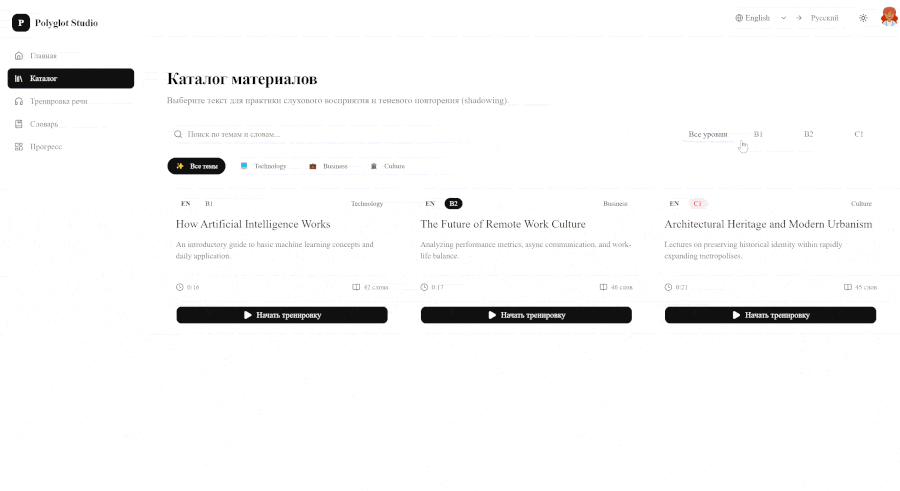

# 🌐 Polyglot Studio

> **Интерактивная Frontend-платформа для аудирования и тренировки беглости речи по методике Shadowing (теневого повторения).**  
> Поддерживает практику английского, французского и турецкого языков с переводом на русский (уровни B1–C1).

---

### 🔗 Ссылки
* 🚀 **Live Demo:** [polyglot-studio.ru](https://polyglot-studio.ru/)
* 📁 **GitHub Repository:** [Исходный код проекта](https://github.com/olga-kozhevina/polyglot-studio)

---

## 🎬 Демонстрация работы приложения

<div align="center">
  
  <p><em>(Интерактивный плеер, синхронизация субтитров, всплывающий перевод и 3D-тренажер карточек)</em></p>
</div>

---

## ⚡ Производительность и аудит (Google PageSpeed Insights)

Приложение прошло комплексный аудит **Google Lighthouse / PageSpeed** с эмуляцией мобильного устройства (Moto G Power) на медленной сети 4G:

| Категория аудита | Результат | Статус |
| :--- | :---: | :---: |
| **🚀 Производительность (Performance)** | **97 / 100** | 🟢 Зелёная зона |
| **♿ Доступность (Accessibility)** | **100 / 100** | 🟢 Идеально |
| **🛡️ Лучшие практики (Best Practices)** | **100 / 100** | 🟢 Идеально |
| **🔍 Поисковая оптимизация (SEO)** | **100 / 100** | 🟢 Идеально |

### Ключевые метрики Core Web Vitals:
* **Total Blocking Time (TBT):** `0 мс` — нулевое время блокировки основного потока скриптами React.
* **Cumulative Layout Shift (CLS):** `0` — абсолютная стабильность макета без сдвигов при загрузке.
* **Largest Contentful Paint (LCP):** `2.4 сек.` — быстрая отрисовка ключевого контента.
* **First Contentful Paint (FCP):** `1.5 сек.`

---

## 📸 Ключевые экраны и возможности

| Раздел приложения | Реализованный функционал и технологии |
| :--- | :--- |
| **📚 Каталог материалов (`/catalog`)** | Витрина текстов с мгновенной фильтрацией по уровням (B1–C1), темам и быстрым поиском |
| **🎧 Интерактивный ридер (`/reader/[id]`)** | HTML5 Audio, синхронизация таймкодов (`useAudioSync`), автоскролл и перевод слов |
| **🎴 3D-тренажёр слов (`/vocabulary`)** | Чистый CSS 3D-Flip, интервальное запоминание (Spaced Repetition) и сохранение хвоста сессии |
| **📊 Дашборд прогресса (`/dashboard`)** | Персональная аналитика, подсчёт серии занятий (Daily Streak) и графики Recharts |

---

## 💡 О проекте и методологии

**Shadowing (теневое повторение)** — доказанная методика развития разговорных навыков: учащийся слушает речь носителя и с минимальным отставанием проговаривает её вслух, копируя темп, паузы и интонации.

**Polyglot Studio** автоматизирует эту практику:
* Текст разбит на точные таймкоды предложений.
* Аудио синхронизировано с визуальной подсветкой и автоскроллом.
* Любое непонятное слово или идиома переводится в один клик и сохраняется в персональный словарь.

---

## 🛠 Технологический стек

* **Фреймворк:** [Next.js](https://nextjs.org/) (App Router, Static Export / SSG)
* **Язык:** [TypeScript](https://www.typescriptlang.org/) (Строгая типизация, контракты данных, Generics)
* **Стилизация:** [Tailwind CSS](https://tailwindcss.com/) + кастомные 3D-утилиты (`perspective`, `preserve-3d`)
* **UI-компоненты:** [Shadcn UI](https://ui.shadcn.com/) (Radix Primitives: Dialog, Popover, Tabs, Table, Slider)
* **Глобальный стейт:** [Zustand](https://github.com/pmndrs/zustand) с middleware `persist` и селекторами
* **Аналитика и графики:** [Recharts](https://recharts.org/)
* **Темизация:** [next-themes](https://github.com/pacocoursey/next-themes) (светлая / тёмная / системная)
* **Иконки:** [Lucide React](https://lucide.dev/)

---

## ✨ Ключевой функционал

### 1. Интерактивный плеер и синхронизация (`/reader/[id]`)
* **HTML5 Audio Engine:** Кастомный плеер с таймлайном, шагом перемотки «-5 сек» для циклической отработки сложных фраз и переключением скорости ($0.75\times$ — $1.5\times$).
* **DOM & Media Sync:** Кастомный хук `useAudioSync` отслеживает воспроизведение и подсвечивает звучащее предложение, а переключатель **Автопрокрутки** мягко удерживает фокус в центре экрана.
* **Переход по клику:** Клик на любое предложение мгновенно перематывает аудио на соответствующий таймкод.

### 2. Умный перевод в контексте
* **Single Word Translation:** Клик по отдельному токену открывает Popover с быстрым переводом.
* **Phrase Selection:** Выделение целой фразы (2+ слов) автоматически определяет границы контекстного предложения через `data-sentence-text` и предлагает перевод составного выражения.

### 3. Словарь и Spaced Repetition карточки (`/vocabulary`)
* **Конкурентная фильтрация:** Поиск по таблице слов реализован через React 19 `useDeferredValue`, исключая лаги при быстром наборе текста.
* **3D Flip Cards:** Карточки тренировки на чистом CSS (аппаратное ускорение через `transform-style: preserve-3d`).
* **Гибкая сессия:** Возможность отфильтровать нужный срез слов (например, только новые) и запустить тренировку конкретного списка. Незавершенный «хвост» сессии сохраняется в localStorage.

### 4. Аналитика и Дашборд (`/dashboard`)
* Отслеживание времени прослушивания раздельно по каждому языку (EN, FR, TR).
* Алгоритм расчёта ежедневной серии занятий (**Daily Streak**).
* Интерактивный график недельной активности с помощью `Recharts AreaChart`.

### 5. Гостевой режим (Guest Experience)
* Приложение полностью доступно для ознакомления без логина.
* Закрытые разделы защищены эстетичным оверлеем с блюром (`GuestFeatureOverlay`), нативно изолированным через атрибут `inert` для доступности (a11y).
* При логине сессия гостя автоматически мигрирует в профиль пользователя.

---

## 🧠 Инженерные решения и компромиссы (Architecture Trade-offs)

1. **Frontend-Only MVP & Persistence:**  
   В проекте нет отдельного бэкенда: авторизация эмулируется на клиенте, а данные изолированы по аккаунтам пользователей в `localStorage` через Zustand.
2. **Борьба с Hydration Mismatch & FOIC:**  
   Поскольку настройки (язык, сессия) хранятся на клиенте, используется флаг регидратации `_hasHydrated` в связке со Skeleton-заглушками для предотвращения мигания контента (*Flash of Incorrect Content*).
3. **Производительность React и подписки Zustand:**  
   Во всех клиентских компонентах используются атомарные селекторы (`state => state.field`), предотвращающие холостые ререндеры при частых событиях плеера (`timeupdate`).

---

## 📂 Структура проекта

```text
polyglot-studio/
├── app/                      # Next.js App Router (SSG / Static Export)
│   ├── catalog/              # Витрина доступных материалов
│   ├── dashboard/            # Аналитика и дашборд
│   ├── reader/[id]/          # Интерактивный плеер и ридер
│   └── vocabulary/           # Таблица слов и 3D-тренажер
├── components/               # UI и бизнес-компоненты
│   ├── auth/                 # Авторизация и модальные окна
│   ├── catalog/              # Карточки и скелетоны каталога
│   ├── dashboard/            # Графики и заглушки гостя
│   ├── layout/               # Шапка, оверлеи и навигация
│   ├── navigation/           # Сайдбар и нижний мобильный бар
│   ├── ui/                   # Атомарные Shadcn UI компоненты
│   └── vocabulary/           # Таблица, фильтры и флип-карточки
├── hooks/                    # Кастомные хуки (useAudioSync, usePhraseSelection)
├── store/                    # Zustand-сторы (Auth, Settings, Vocabulary, Reader, Stats)
├── types/                    # Доменные типы данных TypeScript
└── lib/                      # Утилиты, алгоритмы форматирования и словарь
